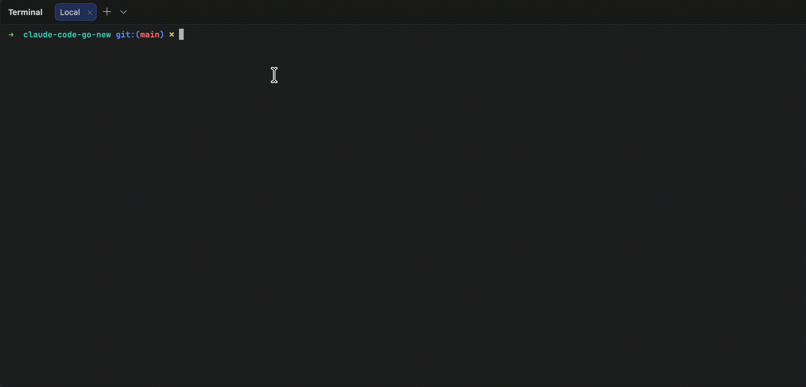

# claude-code-go

一个以单二进制运行的 Go 语言 AI 编程助手，提供交互式终端界面和非交互模式。它可以阅读和搜索代码、编辑文件、执行命令，并把独立任务交给子 Agent。

本项目基于 `@anthropic-ai/claude-code` v2.1.88 的 npm 发布包及其 Source Map 进行还原和翻译，是非官方研究项目，仅供学习与研究使用。



## 快速开始

需要 Go 1.26 或更新版本。配置你使用的 API，在项目根目录启动：

```bash
# OpenAI 或兼容服务
export OPENAI_API_KEY='<你的 API Key>'
export OPENAI_MODEL='<服务提供的模型名>'
# 使用兼容服务时，按服务要求配置地址：
# export OPENAI_BASE_URL='https://your-provider.example/v1'

go run ./cmd/cli --provider openai
```

```bash
# Anthropic
export ANTHROPIC_API_KEY='<你的 API Key>'
go run ./cmd/cli --provider anthropic
```

```bash
# 非交互模式
go run ./cmd/cli --provider openai -p "总结当前项目的目录结构"

# 编译为单个可执行文件
go build -o claude ./cmd/cli
./claude --help
```

可通过 `--model` 和 `--base-url` 覆盖模型和服务地址。Anthropic 也支持 `CLAUDE_MODEL` 和 `ANTHROPIC_BASE_URL`。从源码仓库启动时，当前工作目录就是助手的项目目录；若要操作其他项目，请切到该项目后运行编译好的二进制。

## Web 对话界面

同一个 Go 应用也支持浏览器对话。前端使用原生 HTML / CSS / JavaScript，通过 `go:embed` 编进二进制，无需 Node.js 安装依赖或单独构建。

```bash
# 使用前面的 OpenAI 环境变量启动
go run ./cmd/cli --web --provider openai

# 自定义本地端口；也可搭配 --resume 或 --continue
go run ./cmd/cli --web --web-addr 127.0.0.1:8088 --provider openai --continue

# 编译后同样可用
./claude --web --provider openai
```

打开终端打印的本地地址（默认 `http://127.0.0.1:8080`）。左侧可以新建、搜索和切换当前项目的历史会话；主区域显示流式回复、Markdown 和可展开的工具输入、输出及 diff。工具审批支持允许本次、允许当前对话和拒绝，停止按钮会取消当前查询及该对话的后台任务。右侧任务面板展示子 Agent 运行阶段和结果状态；后台任务完成后自动触发原会话汇总。

点击子 Agent 卡片可查看委派指令、回复和工具执行记录。每次工具调用的输入与输出在同一张可展开的卡片中显示。子 Agent 记录独立存入项目会话目录下的 `agents/<主会话 ID>/<任务 ID>.json`，恢复主会话后可在任务面板查看。服务退出时仍在执行的历史任务会标记为已中断。

浏览器刷新或切换对话不会取消执行，重新连接后重放该会话的流式事件；已保存的会话也可在服务重启后恢复。每条对话独立持有查询引擎、任务和审批状态，模型和项目配置来自启动参数。界面还支持复制回复及导出对话文本为 Markdown（工具详情在页面中单独查看）。

Web 服务仅允许绑定本机回环地址，并检查 Host 和请求来源，API Key 保留在服务端。它面向单机使用，没有远程登录或多用户权限系统。切换项目需在目标目录启动服务；模型通过环境变量或 `--model` 配置。Web 输入框用于模型对话，终端专用的 slash 命令请在 TUI 中使用。`--web` 与 `--print` 不能同时开启。

### 扩展应用

点击对话页右上角的四格图标打开当前项目的应用列表。点击应用即可启动它的 Go 服务，并在右侧标签页直接操作。每个 Web 项目默认安装 **Claude App DevKit**，可以在其中创建 App 脚手架、检查构建产物、安装或更新、停止和卸载应用。构建好的应用可以在没有 Go 工具链的机器上运行。安装记录随 Web 服务重启保留，卸载后保留 App 数据。

在 DevKit 中生成项目，再按页面给出的命令构建。将 App 的绝对目录填入「安装或更新 App」，安装后回到「扩展应用」即可打开。相同 App ID 的新构建会覆盖当前项目中的旧构建，下次打开时使用新版。App 后端以当前系统用户身份运行，请使用可信构建。

已安装应用卡片上的「⋯」菜单可以查看详情和终止运行。终止后关闭该应用的标签页，点击应用卡片即可重新启动。

目前支持本地安装。官方市场和远程发布留到后续阶段。

### Fast Learning 学习画布

在「扩展应用」中打开 **Fast Learning**。输入一个陌生领域的问题，应用会检索公开资料，由当前 Web 项目配置的模型生成交互 SVG 图解。选中图里的知识点，输入自己的追问或沿用推荐问题。新的图解会成为原节点下的分支，来源和摘录可在每个节点内查看。

画布支持拖动、缩放和全览。右上角可以扩大应用面板，查看更长的学习脉络。「我的画布」可以恢复当前项目里保存的记录，「查看光刻机示例」无需调用模型。

默认使用中英文维基百科检索。启动 Web 前设置 `BRAVE_SEARCH_API_KEY` 可优先使用 Brave 网页搜索。检索未返回可核对的资料时，应用会在节点内标明来源状态。

## 子 Agent 与后台任务

可以在对话中让主 Agent 把独立工作委派出去，例如：

> 启动两个后台子 Agent，一个梳理 CLI 启动流程，一个梳理会话保存流程。都结束后汇总。

- 主 Agent 通过 `Agent` 工具创建任务；`run_in_background: true` 会立即返回任务 ID，子 Agent 继续执行。前台模式等待子 Agent 返回。
- 每个子 Agent 从独立的对话开始，初始输入是委派时的任务提示。需要传达给子 Agent 的约束或已做决定，应写进这份提示。它使用与主 Agent 相同的权限检查，工具范围由子 Agent 的工具列表决定。
- TUI 的 **Sub-agents** 面板会显示任务 ID、状态、当前执行阶段和最近的工具活动。宽终端显示在右侧，窄终端显示在底部。
- 后台任务结束后，主 Agent 会在**发起任务的原会话**自动续聊。空闲时直接开始；当前已有回复时，等该轮输出结束后再合并处理通知。
- 续聊会带上当前会话中所有已成功子任务的结果。仍有任务在运行时简要汇报进度；所有任务结束后输出最终汇总，并说明相关失败或停止的任务。自动续聊只生成回复，不会再调用工具。
- 非交互模式也会等待当前会话的后台任务，并输出自动续聊的结果。进程退出后不会继续执行后台任务；恢复会话只恢复已保存的对话。

需要手动检查时，主 Agent 可以调用 `TaskList`、`TaskGet` 查询状态，`TaskOutput` 读取结果，或 `TaskStop` 停止任务。子 Agent **没有整项任务超时**：`TaskOutput` 默认最多等待 30 秒，超时不会停止任务；单次模型 HTTP 请求默认 60 秒，单条 Bash 命令默认 2 分钟、最多 10 分钟。子 Agent 使用同样的 `--max-turns` 配置，默认 100 轮。

## 工具权限

默认模式在 TUI 中请求工具调用确认。审批界面按 `y` 仅批准本次，按 `a` 允许当前运行会话后续调用，按 `n` 或 `Esc` 拒绝。子 Agent 的调用也遵循这些规则；例如项目外的文件写入可能需要单独审批。

用 `Shift+Tab` 循环切换 `default`、`acceptEdits`、`plan`，或用 `/permissions <mode>` 显式选择。启动时也可使用 `--permission-mode <mode>`。

| 模式 | 行为 |
| --- | --- |
| `default` | 工具调用需要审批 |
| `acceptEdits` | 自动允许工作目录内的只读操作及常见文件编辑，其余调用仍需审批 |
| `plan` | 允许工作目录或记忆目录内的只读操作 |
| `dontAsk` | 允许工作目录内的只读操作，拒绝其他调用 |
| `session` | 当前运行会话内免逐次审批 |
| `bypassPermissions` | 跳过逐次审批 |

Bash 安全规则明确禁止的命令仍会被拦截。非交互模式没有审批界面，需要确认的调用会被拒绝。

## 会话保存与恢复

会话按当前项目目录自动保存。普通启动创建新的 session ID，恢复时沿用旧 ID。

```bash
go run ./cmd/cli sessions                       # 列出当前项目的会话，无需配置 API
go run ./cmd/cli --resume <session-id>          # 恢复指定会话
go run ./cmd/cli --continue                     # 继续当前项目最近更新的会话
go run ./cmd/cli --resume <session-id> -p "继续上次的工作"
```

TUI 内用 `/sessions` 或不带参数的 `/resume` 查看列表，用 `/resume <session-id>` 切换会话。启动恢复默认使用保存的 provider 和 model，可通过参数覆盖；TUI 内切换沿用当前运行配置。

会话文件位于 `~/.claude/sessions/<项目绝对路径的哈希>/<session-id>.json`。设置 `CLAUDE_CONFIG_HOME` 时使用该目录，否则优先使用 `$XDG_CONFIG_HOME/claude`，再回退到 `~/.claude`。用户消息在调用模型前保存，完整回复与工具结果随后写入。恢复不会重放旧工具调用；缺失结果的调用会标记为执行状态未知。

`/compact` 压缩模型后续使用的上下文（`messages`），完整对话和工具记录（`history`）仍用于恢复和展示。会话摘要单独维护，不用于还原未保存的历史。

## 终端操作

| 操作 | 用途 |
| --- | --- |
| `Ctrl+O` | 循环切换 Normal、Verbose、Summary 对话视图 |
| `Ctrl+T` 或 `/tools` | 打开工具详情，默认选中最近一次调用 |
| `/diff` | 查看本次会话产生的文件变更 |
| `/compact` | 压缩模型上下文 |

工具详情里，`Tab` / `Shift+Tab` 切换调用，方向键、翻页键或鼠标滚轮滚动，`Home` / `End` 跳到首尾。`/` 搜索，`n` / `N` 切换匹配，`Esc` 或 `q` 返回。详情是打开时的快照，重新打开可以刷新正在运行的工具。收到权限请求时，界面会回到确认区域。

Verbose 视图只显示工具输入、输出及 diff 的预览（最多 8 KiB 源文本、20 行），详情保留本地已有的完整内容。若输出在工具执行层已被截断，界面会单独标记；界面预览本身不改变保存的历史或模型上下文。

开发入口、并发约束和测试说明见 [CLAUDE.md](CLAUDE.md)。
