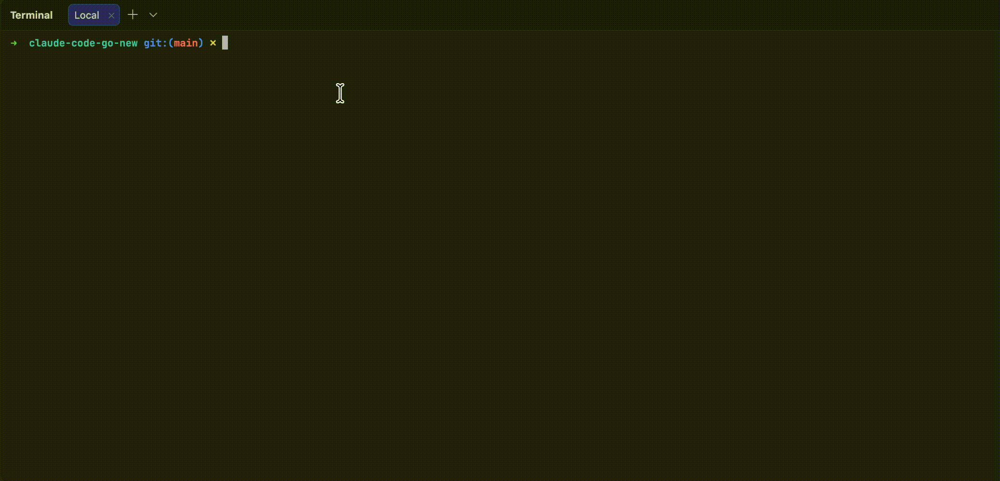

# claude-code-go

## 项目背景

本项目是基于 `@anthropic-ai/claude-code` v2.1.88 npm 发布包及其 Source Map 还原、翻译而来的 Go 语言实现，目标是以单二进制形式提供 AI 编程助手能力。

> 本项目为非官方研究项目，不代表 Anthropic 官方实现，仅供学习与研究使用。

## Demo



## 启动方式

环境要求：Go 1.26 或更高版本。

配置 OpenAI 或兼容服务的地址、API Key 和模型后启动：

```bash
export OPENAI_BASE_URL=""
export OPENAI_API_KEY=""
export OPENAI_MODEL=""

go run ./cmd/cli --provider openai
```

## 功能简介

- 提供交互式终端界面，也支持非交互式调用。
- 支持理解代码库、读写文件、搜索代码及执行终端命令。
- `Ctrl+O` 可循环切换 Normal、Verbose、Summary 三档对话视图。
- 输入 `/diff` 可独立浏览本次会话产生的文件变更。
- 工具权限支持逐次确认、当前会话全部允许、自动接受编辑、规划、禁止询问和绕过确认模式；使用 `Shift+Tab` 或 `/permissions` 切换。
- 支持 OpenAI 兼容接口与 Anthropic API。
- 内置工具权限检查、Bash 安全解析和执行钩子。
- 支持 MCP、LSP、任务、插件、Vim 模式及对话压缩等能力。

## 会话保存与恢复

提交消息后会自动保存当前项目的会话。用户消息在调用模型前落盘，模型回复和工具调用结果在完成后保存；写入采用原子替换，目录权限为 `0700`、文件权限为 `0600`。每次普通启动使用独立 session ID，恢复时沿用原 ID。

```bash
# 查看当前项目的历史会话（无需配置 API）
go run ./cmd/cli sessions

# 恢复指定会话，并显示旧消息；可直接接着输入
go run ./cmd/cli --resume <session-id>

# 继续当前项目最近更新的会话
go run ./cmd/cli --continue

# 也支持恢复后以非交互模式继续执行
go run ./cmd/cli --resume <session-id> -p "继续上次的工作"
```

交互模式下，`/sessions` 或不带参数的 `/resume` 显示历史列表，`/resume <session-id>` 切换会话。启动恢复默认沿用保存的 provider 和 model，可通过启动参数覆盖；交互内切换会话沿用当前 provider、model 和权限设置。

文件位于 `~/.claude/sessions/<项目绝对路径的哈希>/<session-id>.json`；设置 `CLAUDE_CONFIG_HOME` 或 `XDG_CONFIG_HOME` 时遵循对应配置目录。JSON 中的 `messages` 保存模型继续对话所需的上下文，`history` 保留完整对话和工具记录，执行 `/compact` 不会删除历史。`session_memory` 仍独立用于摘要。

恢复不会重新执行旧工具调用。若中断发生在工具执行期间且尚未保存结果，会将该调用标记为执行状态未知，供模型检查当前状态后继续。旧版本未保存的会话正文无法从摘要还原。尚未完成的流式回复可能只保存到上一条完整消息；正常报错或取消时会尽量保留已收到的文本。

## 长工具输出与详情查看

- `Ctrl+O` 继续切换 Normal / Verbose / Summary。Verbose 中每个工具的输入、输出及 diff 仅展示有限预览（最多 8 KiB 源文本、20 行展示），超出部分会提示打开详情。
- `Ctrl+T` 或 `/tools` 打开工具详情，默认选中最近一次调用；详情保留本地已有的完整输入、输出与 diff。工具执行层已截断的输出会单独标记。
- 详情内使用 `Tab` / `Shift+Tab` 切换调用，`↑↓`、`PgUp/PgDn` 或鼠标滚轮滚动，`←→` 横向查看长行，`Home/End` 跳到首尾。
- `/` 输入搜索词，`Enter` 查找，`n/N` 跳到下一处/上一处匹配；`Esc` 或 `q` 返回原会话位置。详情是打开时的快照，查看运行中的工具可退出后重新打开以刷新。
- 主会话按可见区域渲染，缓存最多 256 条消息的展示结果。工具进度和流式文本以约 75 ms 的窗口合并更新；最终回复、工具结果和错误会立即结束等待窗口。

这些限制只影响终端展示，不裁减 session 文件或模型上下文。权限确认仍显示完整输入；查看工具详情时收到权限请求会自动回到确认界面。
